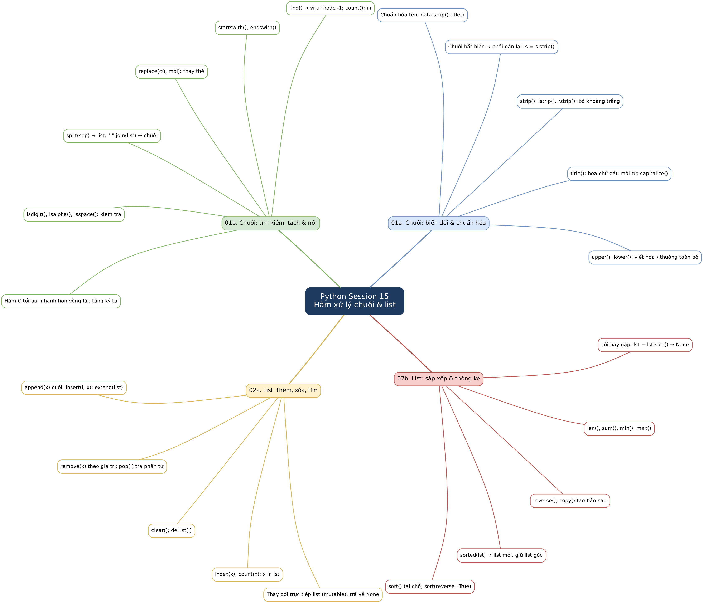

# Mindmap Python Session 15 - Các hàm xử lý chuỗi & list

Sơ đồ tư duy tổng hợp kiến thức Session 15 của khóa Python: **các hàm (phương thức) xử lý chuỗi** và **các hàm xử lý list**.

🔗 **Link mindmap (draw.io):** [Mở mindmap trên draw.io](https://www.draw.io/#R3ZzLbuM2FIafRoBnMYFI6rq0nUm7mCkKzABdBrTNWGx0q0QnTp%2B%2BvMqWRA8GtUVAzkokRYsmvxwe%2FufIHloXxxeaEw998dB6R%2FG%2BwYUH%2FRIXvO7Rg%2FAbLXcFrvmVuqc4%2FtbgOvtW7UiuapqqYqZtTfKcd6c71dkX3eDThVYgW%2F0aN6Rkv9JBPkn2ecP5QQ%2Fwzw%2BWVSWv%2B07alsorEHowyvlHrjYNv9qLq9%2B9NfKWvvhyR%2B8L8FYrb8m7%2B7moX4mrbXbQDWlMPTGUCBc17yruoq1%2Bcss%2BcmKGcyh3RIwN8LveM8rI9xpvRes7nyNel7Ei1818lvN1lVeN7IvAC8Lhi6ivSnZW%2FyL%2FeH3LmuqVXOrxnf4rHsMHqct6VEAOV84QaRg5XpxocL6gpCoIaz7k1MjWxI9Vlw9VjiO1MP473bFM1cFYf2xG6D7THxtDVYdbVd53H31aVn6hV9a%2Byrk%2FWmMf4Ades%2B6tEFryqg2VNUtv9SRW3lsHXgrMTeFwGc0SL71lKm7P5OIjfNOl3WGSvGxtSxhtE7IZLCFndZIlBD6MemsYmvXqrWEyXkMUXb%2BGxCzi2ZyScrdsmuqdl8qq5JWr7aF56yb58myplr%2F0sFE3P2S3Jz%2BfHf786tBsydB8MNzsCTvHbTyPDckxo2%2F9J1zH9fOY7ENdk2bxyYNrYWWqd1mQZL%2BdyGZihSosYX4Sw%2BfcRt7KN5w%2FlntRWykTJ8DemKb0pmhftk5WtNGNUA7DtIdyFMERyshPJ0P5eTKY4f%2BG2fyD9VF%2BdggzGMHMKMuJ4VcBu83MZvvUN8%2FcBMcHXlX09lxm7l5pg41rynDOeRL%2FI3dAsg97JAeBZWNNwulIBrMhGbgjGY5I5t%2BN1p1Z7pUaU1L%2BhwY2EXi%2FZpVhGymT3JjykyjPn18UJT1%2BYZCM%2BU3BdPzC2fAL3fGLRvyuB2eZjeEwZBan%2BQv0kshL5XfNOoJFv710KUApD0q6AWjXuxVdxdP89qH7D5k%2F4iDuIw585NbZQLNBHLlDPLiI%2BPgsx70IQe2yVJzuMMMG0Afjoswf1DQdcGqxxMGEmAazwTRwhSmwCBebC8KFYnQt9KjXkzkulI%2BhGgF3nvv6RWk%2Bhdvgm0oWIUl2gW2NErhBUeRGsgiN4%2FtTxcKfCunrXeNusiZWLJy5xsCiWLxwQVgY0J7b8Gbc4JXyegW%2Bj%2FIQaNCOt7z4GehjHWeVCRdaFGjpyBpbWb6RNY7DvtpmOdYFwWTk3kCguMDuFcYY2Mh1J1AAi0DR8sGw9p2yzJzm%2BDR15dlDGEZ92T4cy2QgAdNRCGZDoUMLOhYXGlLnnKPF1luH3HlVIHY62IpqaYFl%2BEOJvcY7uANE0cBOgsjitvoTMgpnwyh0x%2BhYQGjrnLJFS%2BrhTi8joXLf5o7pP4dqVHj4u6LlQtw27DoIsM6eZRAFPZYRSscsR8l0LKPZsIzcsTxWCmi7o3vKzJZPW5zXGT4VW4GZEXT1YYy7sqiQviy%2BB8egHz8LbaptHE8HajAbUN1pBc%2FhCNSzHJX1WTBMnvZ9FfI9KGjLDJeZEr0irc%2B%2BSf0LyrhD3p266l5QTTa%2BdhkvpmEF7oDxz34%2FZSUeM45MSsQUjIezYTx0xfjY9fWhTOT5Kp2IpU5lEFqtFr6OnYi77mlkt6UTbq3pObtoE4WOtK4oSAdRBhBaHOHJnIfr3eButiYWu5y5wdAidmGensPlrqNwZbeHM3uslauWM7Cgml2tZ5EjE320B%2BzErlrJvZXvEAxA9S3OQzIdqDfQti6geoVhhTZQ3Wlb0KJtNaSo3ohClWWkEtFbquIIp0wEqdBKSuuqXtBPvRwF1Iv%2FxuW56%2FB4BySDYBAxgyC2hHb96VAGs0EZuEN57CVsc4IbEx4QeeYyB8cLV9QL7wFElPZ9VYCSMYgABdOBCGcDosPtf6yC8VAXOUqTuu6iVmabP%2BrQlUTzDrb5gUbAUxWDMZPphPs8mg2TyB2TYzXrhwoLWN506Pb4FRDBVnZKK6i7V1j8RXFgeJMTzXR%2F9%2B%2FCuMJl%2BENM%2BfzBjtJBxCEMLbs%2BDKcDO5gN2M7UL2RRBjZ9ZaDtUmfr7p0tw%2FJ5TgzLumPZSd5aLm9LbrIlds1gk4RB6Lt6pSfoZ4%2BniUUzCCbTuK430N1sTawZODPQyKIZtFUjYw368KQyZs%2FehEhjBa68ryEciVb0%2FNEciCu9wErtrU5ZPhh6EgY%2FR5jeQDG4AOoVBhfZMHWnGCBbNgwHkHChahyp1b7CWU6C8hb29PxtHn3XvrO%2F23vAF%2FoDfIMQucUXzAZf4A5fWxqNNJ1GJ9hW9cfA7Fbnbz4gcVZrcXUPjAbmnYROQLCJshBMxyicDaPQHaNjrzYnpckzaA%2BFuSxoV1vg4%2BIudv0wGByzAIgs%2BkE8HZJoNkg6dE%2FH%2BsHX3othSkzYn%2BULyMOX1LT02138%2BqHzac%2B9BIcCwbToJn1rmqSBJY%2FLn47cYDbkTiQQ8OLpV2Rk2%2FBHZnil%2BXWa0036l2v%2BAw%3D%3D)



## Tóm tắt kiến thức

### Lesson 01: Các hàm xử lý chuỗi

#### Biến đổi & chuẩn hóa

- `upper()` / `lower()`: viết hoa / viết thường toàn bộ chuỗi.
- `title()`: viết hoa chữ cái đầu **mỗi từ**; `capitalize()`: chỉ viết hoa chữ cái đầu **cả chuỗi**.
- `strip()`: bỏ khoảng trắng hai đầu; `lstrip()` bỏ bên trái, `rstrip()` bỏ bên phải.
- Chuỗi là kiểu **bất biến (immutable)**: phương thức trả về **chuỗi mới**, chuỗi gốc không đổi. Phải **gán lại** để giữ kết quả: `s = s.strip()`.
- Chuẩn hóa tên: `data.strip().title()`, làm sạch trước rồi mới định dạng (method chaining chạy từ trái sang phải).

```python
name = "  nGUYỄN vĂN aN  "
print(name.upper())                 #   NGUYỄN VĂN AN
print(name.lower())                 #   nguyễn văn an
print("hello world".title())        # Hello World
print("hello world".capitalize())   # Hello world

name.strip()                        # không gán lại -> name không đổi
print(f"[{name}]")                  # [  nGUYỄN vĂN aN  ]

name = name.strip().title()         # gán lại
print(f"[{name}]")                  # [Nguyễn Văn An]
```

#### Tìm kiếm, tách & nối, kiểm tra

- `find(x)`: vị trí xuất hiện đầu tiên, **-1** nếu không có; `count(x)`: số lần xuất hiện; `x in s`: có hay không.
- `startswith()`, `endswith()`: kiểm tra đầu / cuối chuỗi.
- `replace(cũ, mới)`: thay thế chuỗi con.
- `split(sep)`: tách chuỗi thành **list**; `"sep".join(list)`: nối list thành **chuỗi**.
- `isdigit()`, `isalpha()`, `isspace()`: kiểm tra loại ký tự, hay dùng để validate dữ liệu nhập.
- Các phương thức chuỗi được viết bằng C nên **nhanh hơn nhiều** so với vòng lặp duyệt và nối từng ký tự (nối chuỗi trong vòng lặp tạo rất nhiều chuỗi mới do tính bất biến).

```python
email = "an.nguyen@rikkei.edu.vn"
print(email.find("@"), email.find("#"))   # 9 -1
print(email.count("n"), "@" in email)     # 4 True
print(email.startswith("an"), email.endswith(".vn"))   # True True
print("Toi hoc Java".replace("Java", "Python"))         # Toi hoc Python

words = "python,java,c++".split(",")
print(words)                  # ['python', 'java', 'c++']
print(" - ".join(words))      # python - java - c++

print("2026".isdigit(), "abc".isalpha(), "   ".isspace(), "12a".isdigit())
# True True True False
```

### Lesson 02: Các hàm xử lý list

#### Thêm, xóa, tìm

- `append(x)`: thêm vào cuối; `insert(i, x)`: chèn vào vị trí `i`; `extend(list)`: nối thêm nhiều phần tử.
- `remove(x)`: xóa theo **giá trị** (lần xuất hiện đầu tiên); `pop(i)`: xóa theo **vị trí** và trả về phần tử đó (mặc định phần tử cuối).
- `clear()`: xóa hết; `del lst[i]`: xóa theo chỉ số.
- `index(x)`, `count(x)`, `x in lst`: tìm kiếm.
- List là kiểu **có thể thay đổi (mutable)**: các phương thức sửa **trực tiếp** list và thường trả về `None`.

```python
lst = [3, 1, 2]
lst.append(5)          # [3, 1, 2, 5]
lst.insert(0, 9)       # [9, 3, 1, 2, 5]
lst.extend([7, 8])     # [9, 3, 1, 2, 5, 7, 8]
lst.remove(9)          # [3, 1, 2, 5, 7, 8]
x = lst.pop()          # x = 8, lst = [3, 1, 2, 5, 7]
print(lst.index(2), lst.count(1), 5 in lst)   # 2 1 True
print(lst.append(6))   # None (append sửa list, không trả về list)
```

#### Sắp xếp & thống kê

- `sort()`: sắp xếp **tại chỗ** (sửa list gốc); `sort(reverse=True)`: giảm dần.
- `sorted(lst)`: trả về **list mới** đã sắp xếp, list gốc giữ nguyên.
- `reverse()`: đảo ngược tại chỗ; `copy()`: tạo bản sao độc lập.
- Hàm thống kê: `len()`, `sum()`, `min()`, `max()`.
- Lỗi hay gặp: `lst = lst.sort()` làm `lst` thành `None`. Ngược với chuỗi, phương thức list **không cần gán lại**.

```python
nums = [5, 2, 8, 1]
print(sorted(nums), nums)   # [1, 2, 5, 8] [5, 2, 8, 1]
nums.sort()                 # [1, 2, 5, 8]
nums.sort(reverse=True)     # [8, 5, 2, 1]
nums.reverse()              # [1, 2, 5, 8]

backup = nums.copy()
backup.append(100)
print(nums, backup)         # [1, 2, 5, 8] [1, 2, 5, 8, 100]
print(len(nums), sum(nums), min(nums), max(nums))   # 4 16 1 8

bad = [3, 1, 2]
bad = bad.sort()
print(bad)                  # None
```

## Bảng so sánh nhanh: chuỗi vs list

| Tiêu chí | Chuỗi (`str`) | List (`list`) |
|---|---|---|
| Tính chất | Bất biến (immutable) | Thay đổi được (mutable) |
| Phương thức trả về | Chuỗi **mới** | Thường là `None` (sửa trực tiếp) |
| Cách dùng đúng | `s = s.strip()` (phải gán lại) | `lst.sort()` (không gán lại) |
| Lỗi hay gặp | Gọi `s.strip()` mà không gán → không đổi | `lst = lst.sort()` → `None` |
| Chuyển đổi qua lại | `s.split()` → list | `" ".join(lst)` → chuỗi |
